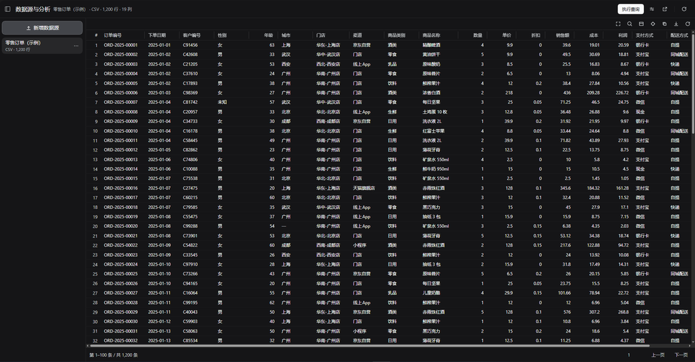
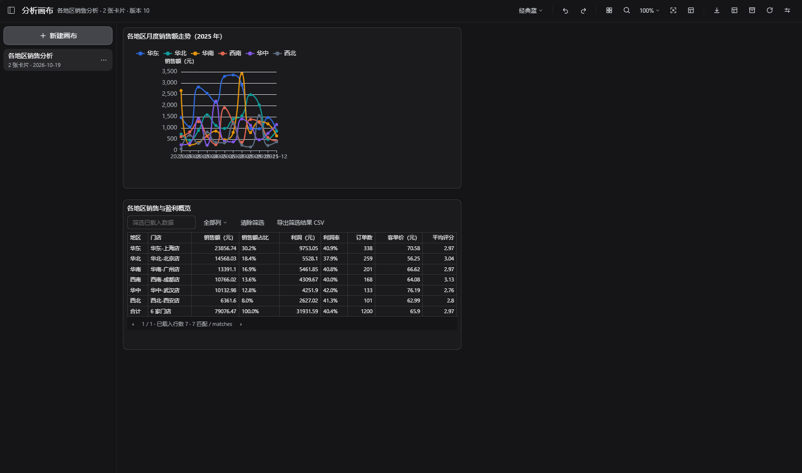
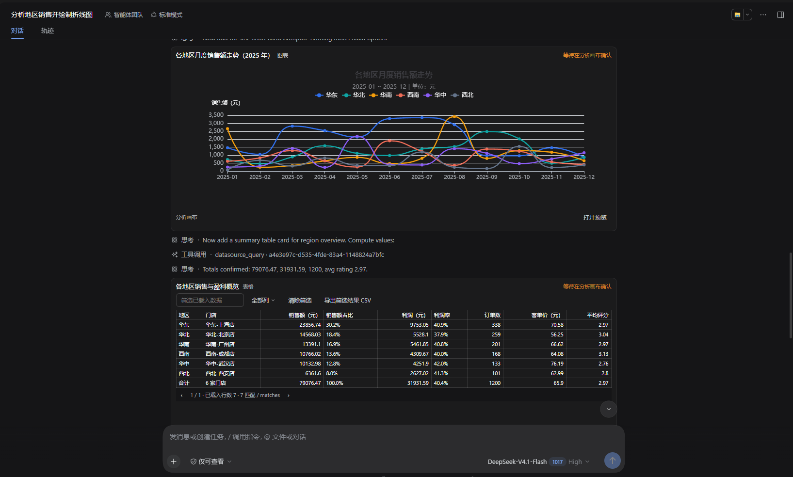

# data-canvas-dsh

> 把数据变成**可复用的分析卡片**：导入文件或连接数据库（只读），查询、看结果、落卡、在对话里引用、追溯每个数字的来源。

这是 DeepSeek Harness 的一个插件。它不要求你写代码，也不接管你的数据：文件与查询结果都保存在本机，数据库只读访问，密码不会离开这台电脑。

**它适合谁**

- 想在一个地方反复查看同一批分析结果，而不是每次重新问 AI；
- 需要把「某个数字怎么来的」讲清楚（查询、数据源、卡片版本都能追溯）；
- 用聊天推进分析，但希望结果能沉淀成卡片、随时回来改。

---

## 装上之后，先看示例

安装并重启 DSH 后，打开侧边栏的「**数据源**」，列表里已经有一份：

> **零售订单（示例）** — 1,200 行、19 列

不需要你准备任何数据。它包含 2025 年全年的订单：门店、渠道、商品类别、数量、单价、折扣、销售额、成本、利润、评分等，还带少量缺失值，用来展示解析提示。你可以直接查询它，也可以随时删除。

想用自己的数据：点「新增数据源」拖入 CSV/TSV/XLSX/Parquet，或连接 MySQL/PostgreSQL。



## 五分钟上手

**1. 看一份数据**

左侧选中「零售订单（示例）」，右侧就是数据预览；表结构栏会列出字段，点表名可展开字段，右键可看完整表结构或 CREATE TABLE 语法。

**2. 查一个问题**

- **文件数据源**（包括示例）：点「配置查询」，选择「门店」作为分组、指标「销售额 · 求和」，执行；
- **数据库**：在 SQL 框里写查询，Ctrl/Cmd + Enter 执行：

```sql
SELECT store, SUM(amount) AS amount
FROM orders
GROUP BY store
ORDER BY amount DESC
```

**3. 把结果留下来**

- 点「添加到画布」→ 结果变成一张卡片，在「分析画布」里拖拽布局；
- 点「在对话中使用」→ 把结果的引用发给 AI，它回答时会先读取这份结果；
- 卡片菜单里可以查看**溯源**：这张卡片来自哪次查询、哪个数据源、哪个版本。

**4. 回到对话继续**

在聊天里引用数据源或结果，AI 会基于真实数据回答；追问卡片时，它会沿着卡片版本继续，而不是重新猜。





## 功能一览

**数据源**

- 文件：CSV / TSV / XLSX / Parquet，导入时给出编码、分隔符、缺失值等解析提示，失败可调整设置重试；
- 数据库：MySQL / PostgreSQL，只读连接，支持测试连接、表结构浏览、按字段名找表；
- 查询：只读 SQL（单条、自动 LIMIT、15 秒超时、可取消）、常用 SQL、最近执行、格式化。

**结果**

- 表格：排序、列显隐、列宽拖拽、冻结首列、全屏、表内搜索、复制、导出 CSV、字段画像；
- NULL 与空字符串区分显示（NULL 是淡灰「—」）；
- 结果可添加为画布卡片，或在对话里引用。

**分析画布**

- 网格布局、拖拽/缩放、对齐、撤销重做；
- 卡片数据版本与溯源、复算（结果口径变化会提示）。

**数据管理**

- 引用协议 `xcharts:ds/...`、`xcharts:res/...`、`xcharts:card/...`，AI 先解析引用再回答；
- 使用情况（哪些卡片/会话用过这份数据）、备份/恢复、存储占用与清理、插件内更新记录。

## 安装

前置：DeepSeek Harness（桌面或 `dsh web`），Node.js 22+。

**方式一：插件管理器**（发布后）

在 DSH 的插件管理器里安装 `data-canvas-dsh`，然后重启。

**方式二：从源码安装**

把本仓库放进 profile 的 `node_modules/`，在 profile 的 `package.json` 里声明：

```json
{
  "dependencies": { "data-canvas-dsh": "link:<path-to-data-canvas-dsh>" }
}
```

并在 `dsh.profile.bundles` 中加入 `data-canvas-dsh`，然后重启 DSH。

> 宿主侧的路由与工具在启动时加载，因此**安装或升级后需要重启 DSH**；浏览器页面刷新即可。

## 安全与隐私

- **只读**：数据库连接使用只读事务；SQL 守卫只放行单条查询，拒绝写操作、DDL、多语句；插件不提供数据编辑。
- **密码不出本机**：凭据用 AES-256-GCM 加密保存在本地 `secrets/`；数据源列表、Agent 工具输出、日志、备份、导出文件中都没有密码。
- **主机打码**：工具与溯源输出中显示 `10.0.*.*` 这样的形式。
- **数据不离开本机**：插件不向外部服务上传数据；AI 只能通过你主动引用的内容看到数据。

建议连接数据库时使用**只读账号**——代码守卫是纵深防御，不能替代数据库权限。

## 兼容性

- DSH：开发与验证于 `0.2.0-rc.2` 系列；
- Node.js：22+；
- 数据库：MySQL 5.7+ / PostgreSQL 12+；
- 文件：CSV / TSV / XLSX / Parquet，单文件最多 50,000 行；
- 数据源结果最多保存 5,000 行。

## 常见问题

**示例数据从哪来？可以删吗？**
来自仓库的 `examples/retail-orders.csv`，首次运行时自动导入。可以随时删除，删掉后不会被重新加回来。想找回：删除 `~/.dsh/storages/xcharts-canvas/.example-source-imported` 后重启，或手动导入该文件。

**数据存在哪里？**
默认 `~/.dsh/storages/xcharts-canvas/`（画布、数据源、结果、凭据）。备份/导出在「设置」里操作，备份不包含密码。

**为什么连不上数据库？**
先用「测试连接」确认主机、端口、库名与账号；只读账号需要相应表的查询权限。错误提示会给出可操作建议。

**能修改数据库里的数据吗？**
不能，这是刻意的设计。插件只用于分析，写操作请用专门的数据库工具。

**SQL 有没有限制？**
单条语句、只读、自动加 LIMIT、15 秒超时；`SELECT` / `WITH` / `EXPLAIN` / `SHOW` / `DESCRIBE` 等可执行。

## 更多文档

- [使用说明](docs/usage.md) — 界面、功能与常见操作
- [架构](docs/architecture.md) — 宿主/客户端、数据存储、API、引用协议
- [安全](docs/security.md) — 只读、凭据、脱敏、威胁模型与限制
- [开发](docs/development.md) — 构建、测试、代码组织与发布

## 开发

```bash
pnpm install
pnpm build:client   # 拼接 client-src 为 client.js
pnpm test           # 构建 + 全量测试
pnpm pack           # 生成可安装的 tgz
```

示例数据可用 `python scripts/make-example-data.py` 重新生成（固定随机种子）。

## 许可与贡献

[MIT](LICENSE)。欢迎 issue 与 PR；提交前请跑 `pnpm test`。

依赖许可：`pg`、`mysql2`、`hyparquet`、`csv-parse`、`exceljs` 为 MIT，`echarts` 为 Apache-2.0。
